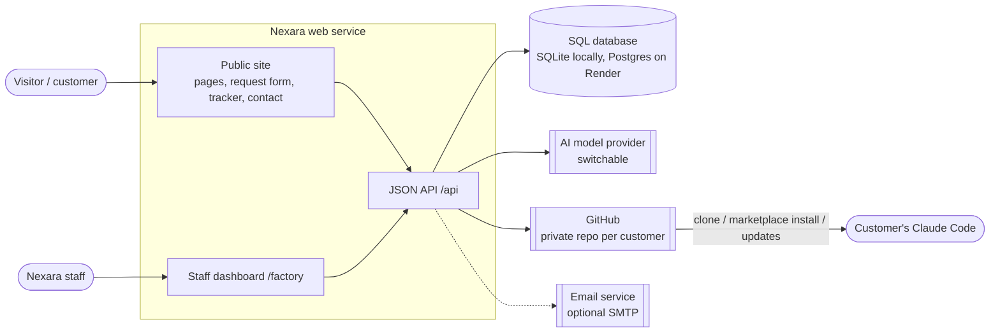
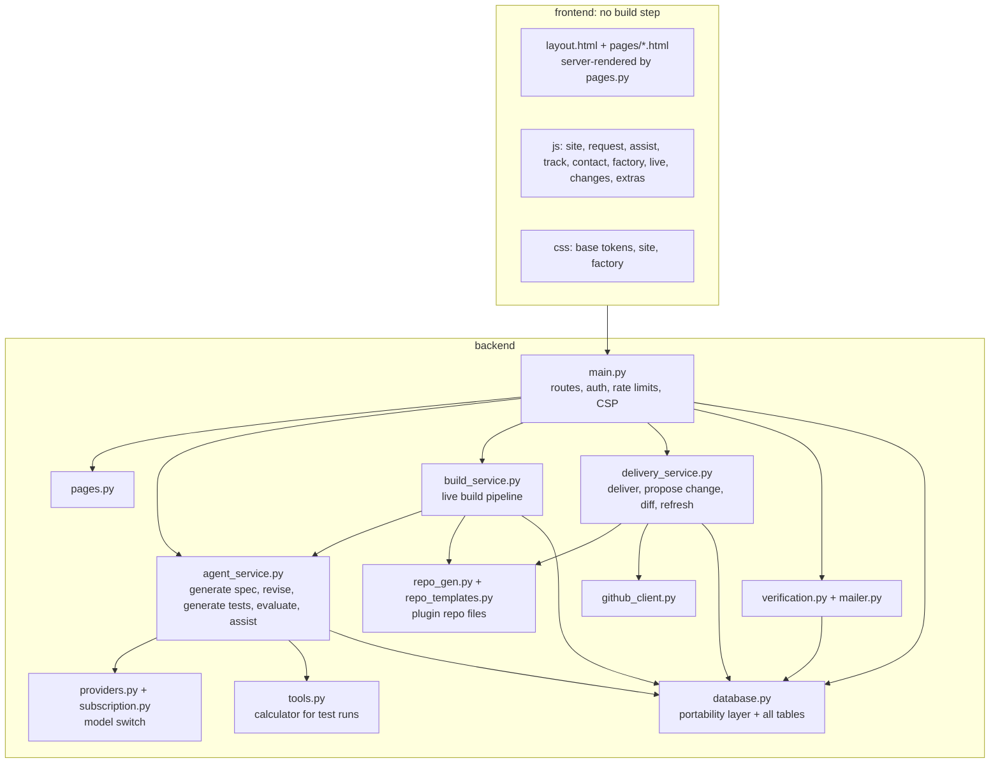
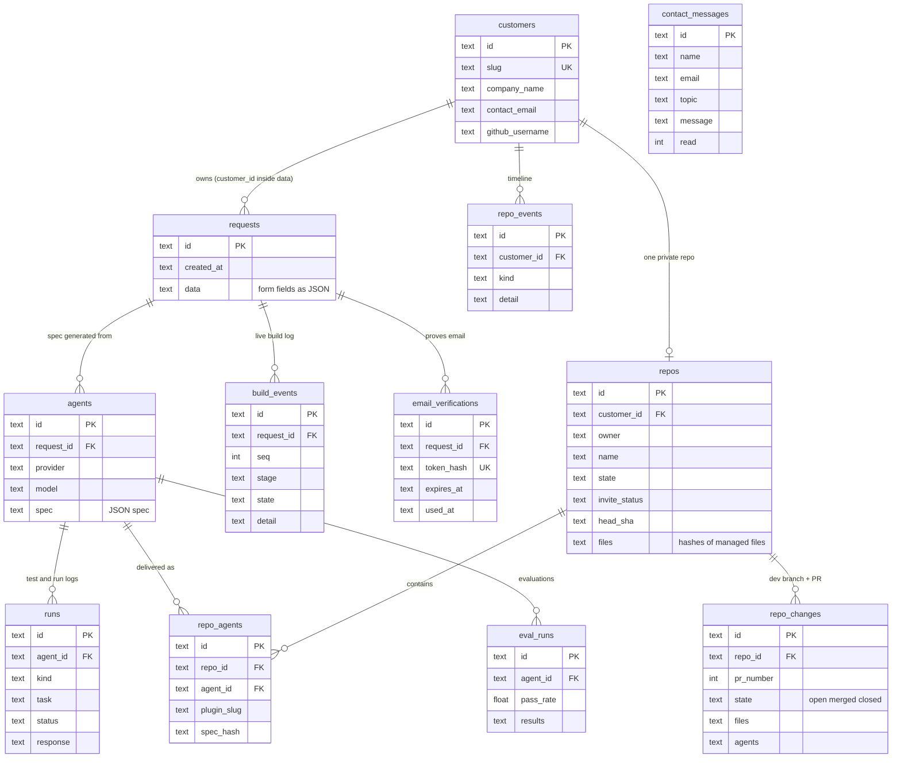
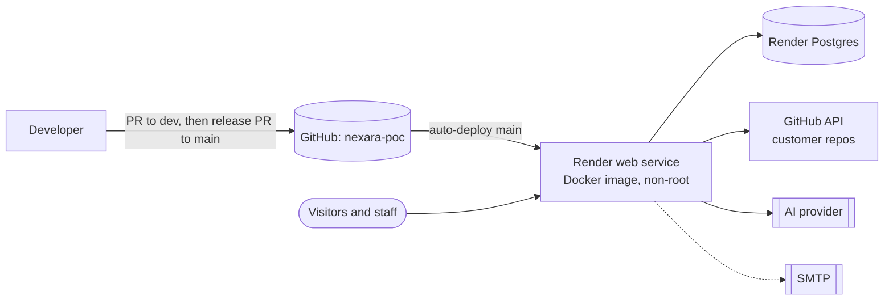

# Architecture

Nexara POC is one Python web service (FastAPI) with a vanilla-JS front end, a SQL database, and a handful of outbound integrations. There is no build step and no background worker: long jobs run as asyncio tasks inside the web process.

## System context

## Components

## Data model
Every table is plain SQL created by `database.init_db()`; the same SQL runs on SQLite and Postgres (`?` placeholders are rewritten for Postgres). JSON is stored as text.

## Deployment

- One container, started by `Dockerfile`; `PORT` from the platform; `/api/health` is the health check.
- Env vars (see `.env.example`, `render.yaml`): `FACTORY_PASSWORD`, `AI_PROVIDER` plus a provider key or `CLAUDE_CODE_OAUTH_TOKEN`, `DATABASE_URL`, `GITHUB_TOKEN`, `GITHUB_OWNER`, `SMTP_*`, `REQUIRE_EMAIL_VERIFICATION`, `TRUSTED_PROXY_HOPS`, rate-limit knobs, and the legal/contact settings (`LEGAL_NAME`, `POLICY_EFFECTIVE`, `POLICY_REVIEWED`).
- Restarts interrupt a running build; startup marks it interrupted so the UI never spins forever.
- API docs (`/docs`) are disabled when `RENDER` is set.

## Cross-cutting rules
- Security headers and a strict CSP (`script-src 'self'`, no inline scripts) are added in `main.py`.
- Public endpoints are rate-limited per client IP (`limit()`); staff endpoints require the shared dashboard token (demo-grade auth, see `docs/flows.md` security model).
- All outward actions are confirmed by a human and logged as events.
