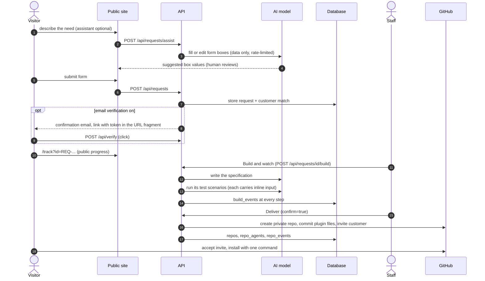
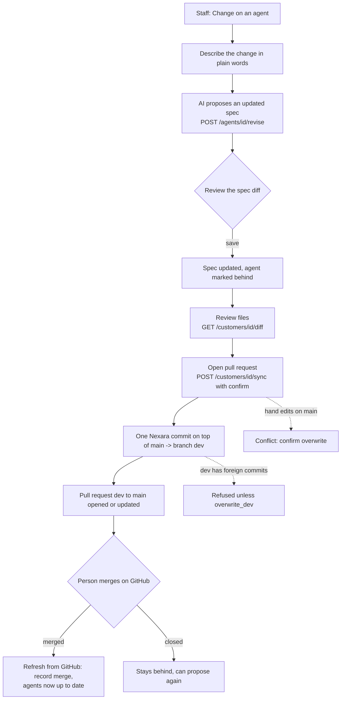
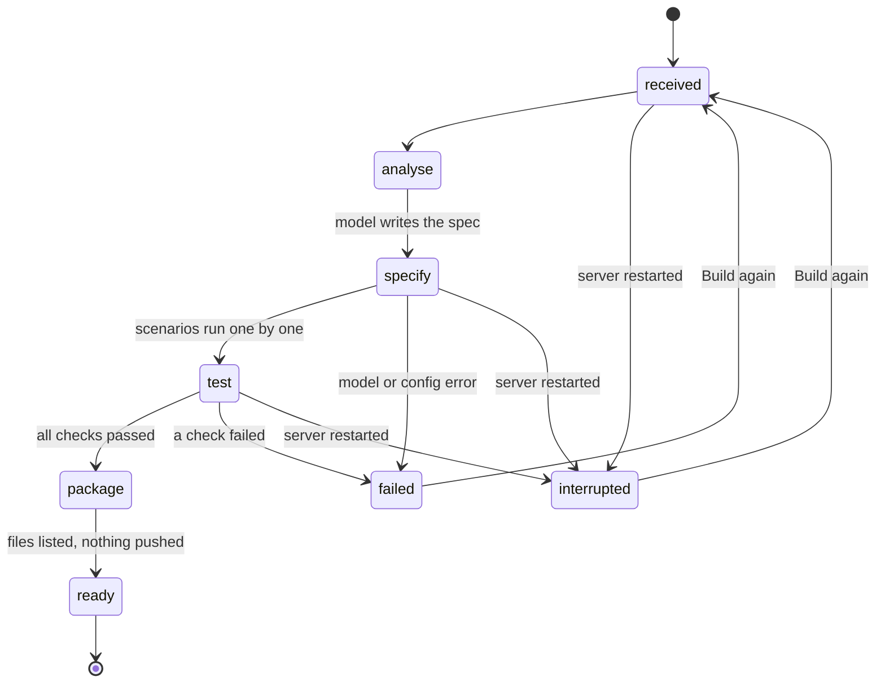
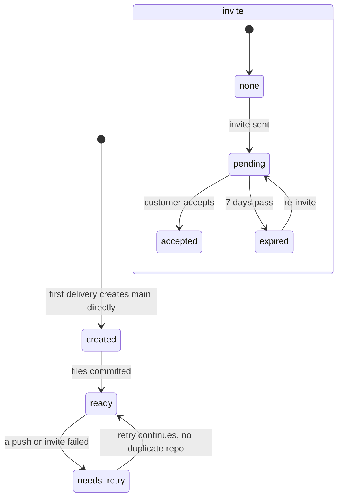
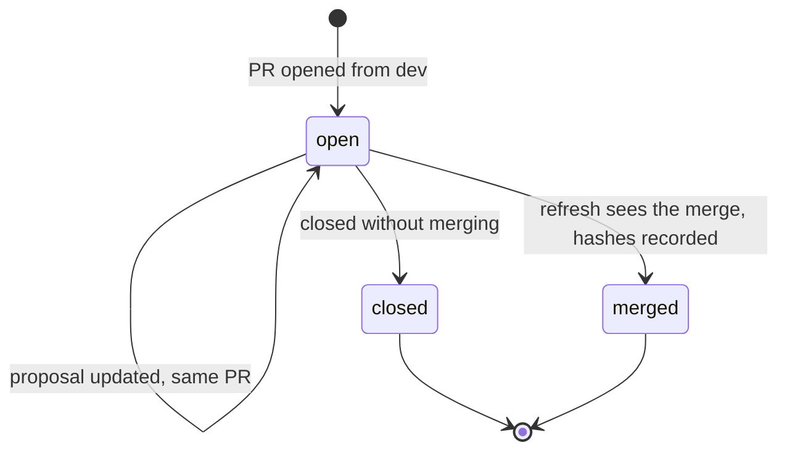
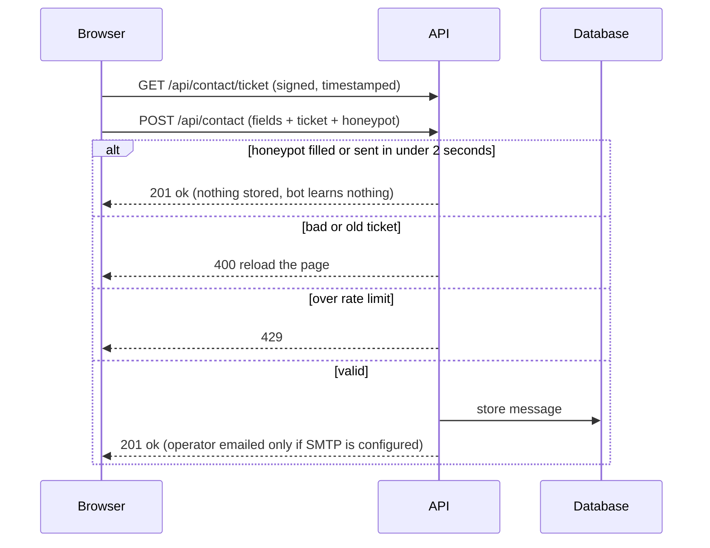

# End-to-end flows

## 1. From a visitor's idea to a delivered plugin

## 2. Changing something already delivered (dev branch + pull request)

## 3. Live build pipeline

The public tracker maps these to five friendly steps and exposes only step names and states.

## 4. Customer repository and invitation states

## 5. Pull-request change record

## 6. Public contact form

## Security model (summary)
- **Who can do what.** Visitors: read pages, submit requests/contact, assist (rate-limited), track by reference (step names only). Staff (shared dashboard password -> in-memory token, lockout after repeated failures): everything else.
- **Outward actions need `confirm: true`:** create repo, push, invite, open PR, send verification email. Each is logged as an event.
- **Customer matching is strict** (company, GitHub user and email must all match) so a stranger cannot attach to someone else's repo; unverified email blocks delivery (unless explicitly disabled).
- **Untrusted text** never becomes executable generated code (only comments); user text is escaped on output; model output is validated against pydantic models and field whitelists.
- **Public text** never reveals internals; a test enforces it. A strict CSP and security headers are on every response.
- **Secrets** only in env; none in logs, events or docs.
